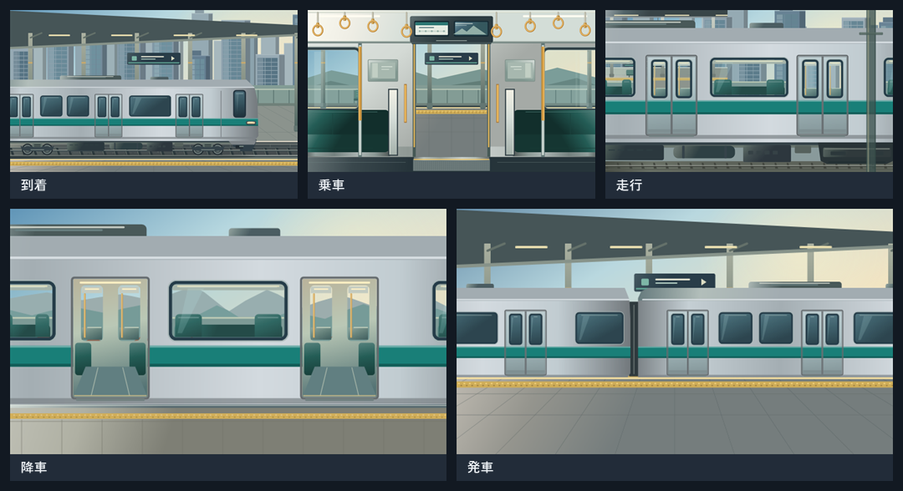

# 旅行列車

AviUtl2で列車の到着、乗車、走行、降車、発車を描くメディアオブジェクトです。通勤電車2種と特急2種から車両を選び、ホームや車内に立ち絵を重ねられます。

## 導入

64ビット版Windowsで動作するAviUtl ExEdit2 v2.1.16以降に対応しています。

1. [v1.0.0の配布ページ](https://github.com/vramwiz/SYNC_TravelTrain/releases/tag/v1.0.0)から `SYNC_TravelTrain.zip` を取得して展開します。
2. AviUtl2を終了し、展開した `SYNC_TravelTrain` フォルダーごと `C:\ProgramData\aviutl2\Plugin\` に入れます。
3. AviUtl2を起動し、メディアオブジェクトの追加メニューで「SYNC」→「旅行列車」を選びます。

更新時は同じ場所に上書きします。削除する場合は、AviUtl2を終了してから `Plugin` 内の `SYNC_TravelTrain` フォルダーを取り除きます。

## シーンを設定する

- 「シーンプリセット」で場面を選び、「時間（秒）」で停車、扉の開閉、走行などの長さを調整します。乗降時は開扉時間か閉扉時間を `0` にすると扉が閉じたままになります。
- 「列車プリセット」で車両を選びます。「列車の配色を反映」を押すと車種の既定色に戻り、「車体の配色」で車体と帯の色を変更できます。
- 「風景」でビル街、住宅街、田園、海岸を選びます。「走行高さ」は全シーンで使えます。目安は `-1` が地下、`0` が地上、`2` 以上が高架です。
- 走行の速さは「風景」→「走行速度（px/秒）」で調整します。初期値は `510` です。加速・減速にかける時間は「時間（秒）・走行」で調整できます。
- 「描画サイズ」の幅・高さが `0` のときは、シーンと同じサイズで描画します。

乗車シーンの作例は [サンプルプロジェクト](https://github.com/vramwiz/SYNC_TravelTrain/blob/main/Aup2/sample.aup2) から取得できます。

## 立ち絵を重ねる

「旅行列車」を複製して開始位置、長さ、設定をそろえ、「描画レイヤー」で各オブジェクトに必要な項目を表示します。下表の順に奥から手前へ重ねてください。

| シーン | 奥から手前への重ね順 |
| --- | --- |
| 到着 | ホーム背景 → 立ち絵 → 列車本体 |
| 乗車 | ホーム背景・足元 → 乗車前の立ち絵 → 扉 → 乗車後の立ち絵 → 車内 |
| 走行 | 風景・車内・座席 → 立ち絵 → 車体・窓・前景物 |
| 降車 | ホーム・車体・車内 → 降車前の立ち絵 → 扉 → 降車後の立ち絵 |
| 発車 | ホーム・列車 → 立ち絵 |

乗降時は扉が開いている間に立ち絵を扉の前後で切り替えます。走行から降車につなぐときは、列車プリセット、配色、風景の設定をそろえると、到着ホームと車両の構図がつながります。

## ライセンス

本体は [GPL-3.0-only](LICENSE) です。AviUtl2 SDKのライセンスと出典は [ライセンスと出典](LICENSES.md) に記載しています。
